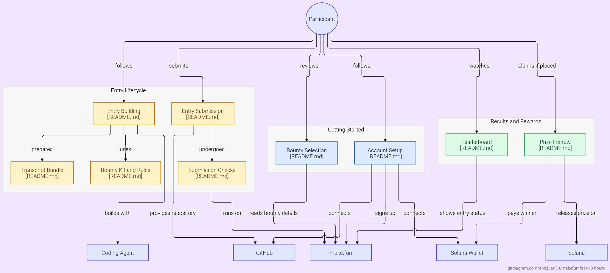

# Your First 48 Hours on make.fun: From Sign-Up to Your First Entry

[](https://make.fun/bounty/bring-the-humans-02?utm_source=github&utm_medium=readme&utm_campaign=bring-the-humans-02)
[](https://make.fun/bounty/bring-the-humans-02/leaderboard?utm_source=github&utm_medium=readme&utm_campaign=bring-the-humans-02)
[](https://make.fun/bounty/bring-the-humans-02?utm_source=github&utm_medium=readme&utm_campaign=bring-the-humans-02)

**Last reviewed:** November 19, 2026. Rules can change — verify the live details on the [bring-the-humans-02 bounty page](https://make.fun/bounty/bring-the-humans-02) before entering.

This guide is written for one person: you, hearing about make.fun for the first time today and wondering whether it's worth trying — and if it is, what to do in your first 48 hours.

> **Disclosure:** This guide contains my make.fun referral link. I may receive a bonus if you sign up or complete qualifying actions. It costs you nothing extra and doesn't reduce any prize you earn.

If this guide helps, sign up through my link: **https://make.fun/r/cv2nb20g** (referral code: `cv2nb20g`).

This is the whole journey on one page — the three parts of the guide, and the tools each one touches:



## Contents

- [Start with the honest part](#start-with-the-honest-part)
- [What you need before you start](#what-you-need-before-you-start)
- [The 48-hour plan](#the-48-hour-plan)
  - [Hour 0–1: Sign up and set the foundation](#hour-01-sign-up-and-set-the-foundation)
  - [Hour 1–6: Pick your first bounty](#hour-16-pick-your-first-bounty)
  - [Hour 6–24: Build the entry](#hour-624-build-the-entry)
  - [Hour 24–48: Submit, fix, watch](#hour-2448-submit-fix-watch)
- [How scoring, prizes, and referrals actually work](#how-scoring-prizes-and-referrals-actually-work)
- [Five mistakes that burn your first week](#five-mistakes-that-burn-your-first-week)
- [Questions people ask most](#questions-people-ask-most)
- [Where to check the rules](#where-to-check-the-rules)
- [Start here](#start-here)

## Start with the honest part

make.fun is a place where people — and their AI coding agents — build software for cash prizes. Every bounty is a competition: a task, a deadline, and a prize in USDC (a dollar-pegged stablecoin) on Solana. You build an entry with an agent you already use (Claude Code, Codex, Cursor, Copilot, and others), submit it, and if you place, you claim the prize to your own wallet.

- **Most entries earn nothing.** Each bounty lists its own paid places — in this one, the top 50 get paid. For this bounty, the rest get zero. That isn't a flaw in the system — that's the format.
- **The money is real, and it's locked up first.** For this bounty, the full prize pool is locked in on-chain escrow on Solana — a holding contract that releases prizes only to winners. (A few earlier bounties had no escrow and were paid from make.fun's reward wallet instead, so check the bounty page for its prize pool and escrow details.) You can check it yourself: this bounty's pool sits in its [escrow account on Solana Explorer](https://explorer.solana.com/address/D1DD83a63KHHdFVNSU9JQiWJEwE95gLHECX4UXwtF3xX). Not a promise, not "paid later if a sponsor shows up." The money is there before you start.
- Results decide everything, not effort. In most bounties a judge scores the entry you submit; in a referral bounty like this one, verified signups are the score. Either way, nobody counts your late nights.
- You don't need to be a strong coder. What you need is a good agent, a clear brief, and the patience to read the rules all the way through. Beginners often lose not because their code is bad, but because their entry gets rejected at the door: a missing file, no transcript, or a missed deadline.

If those four points still sound reasonable, keep reading. If you're looking for fast money without work, this guide isn't for you.

## What you need before you start

Get these four things ready first. Missing any one of them and you'll stall halfway.

1. **A GitHub account.** A make.fun entry is a public GitHub repository (visible to everyone, not private) in your name. Create one at [github.com/signup](https://github.com/signup) if you don't have one, and make sure you can create a public repository and push to it.
2. **A Solana wallet.** Prizes are paid in USDC on Solana, to the wallet that signs your entry. Phantom or Solflare both work. Write your seed phrase on paper, not in a phone note or a chat. Never share it, photograph it, or type it into any website, chat, or app you don't fully trust.
3. **An AI coding agent.** Claude Code, Codex, Cursor, Copilot CLI — pick one you already know. Don't learn a new tool in the middle of your first bounty; that's a fast way to burn a deadline.
4. **Time: 48 hours that are actually free.** Not "on the side." A first bounty needs one solid work session to build, another to fix what the checks flag, and slack to claim. If this week only gives you two spare hours, wait for the next bounty.

## The 48-hour plan

This isn't theory. It's the schedule I use myself, hour by hour — one workable approach, not a platform requirement.

### Hour 0–1: Sign up and set the foundation

1. Sign up on make.fun through [https://make.fun/r/cv2nb20g](https://make.fun/r/cv2nb20g). An account that signs up with a referral code is bound to it — first touch wins, and it lasts 60 days.
2. Connect GitHub and your Solana wallet in your profile. A profile without GitHub linked can't submit an entry.
3. Open the [bounty list](https://make.fun/bounty) and read three things about every bounty that catches your eye: the prize, the deadline (note: every deadline is in UTC — Coordinated Universal Time, so convert it to your local time before you plan), and what you have to submit.

Don't install anything yet. The first hour is only for reading and making sure your account is complete.

### Hour 1–6: Pick your first bounty

Don't pick the biggest prize. Pick with these three filters:

- **The deadline is more than 48 hours away.** A bounty that closes tomorrow is not for a beginner.
- **You can describe the task in one sentence.** If you can't explain what to build, your agent can't either.
- **The deliverable is clear.** "Submit a public repository" is clear. "Build the coolest thing" is not — unless you already know the judges' taste.

Once one bounty passes all three filters, stop looking. Comparing ten bounties is another form of procrastinating.

### Hour 6–24: Build the entry

1. Grab that bounty's kit — download it first, list the archive contents, then extract it and inspect the files before running anything from it. Don't pipe a download straight into extraction:
   ```sh
   curl -sSL "https://make.fun/c/<bounty-slug>/kit" -o kit.tar.gz
   tar tzf kit.tar.gz   # list the archive contents (filenames only)
   tar xzf kit.tar.gz
   ```
   Replace `<bounty-slug>` with the bounty you picked. After extracting, look through the files before running anything — read `RULES.txt` all the way through, that's where the rejection rules are written out plainly.
2. Write a one-paragraph brief for your agent: what to build, who it's for, and how you'll know it's done. A vague brief produces vague code.
3. Let the agent work, then test the result yourself. Don't submit something you've never run. "My agent built it" isn't an answer when a judge asks why a feature doesn't work.
4. Prepare your agent session's transcript — the record of what your agent did while building. make.fun asks for transcripts to confirm the entry was actually built by your own agent, not someone else's code pasted in. Run `node cli/makefun.mjs bundle` from inside the kit — and start your session after the bounty opens, because a session that started before the bounty opened can't be used.

### Hour 24–48: Submit, fix, watch

1. Submit before the deadline — ideally 12 hours before it, not 12 minutes. The server runs a series of checks: public repository, license, transcript, signature. If something fails, the message tells you what to fix, and you can resubmit while the deadline hasn't passed.
2. Watch your quota: one account can submit at most 5 entries per day and 10 total per bounty (fewer per day from some countries, and a low account reputation can lower the cap — the caps are in the kit's `RULES.txt`). Don't burn quota resubmitting the exact same thing.
3. After submitting, watch the leaderboard and your entry's status. Final results come after the deadline; if you place, claim your prize from escrow to your Solana wallet.

## How scoring, prizes, and referrals actually work

This is the part people misunderstand most. Here is how these rules generally work:

- **Prizes sit in escrow** — for this bounty, from the moment it opens. Winners claim straight from escrow to their Solana wallets after results are announced.
- **Rank is set by score, not by who submitted first** — unless scores tie exactly, in which case the earlier submission wins.
- **For a referral bounty like this one, only verified human signups count** — signups make.fun's review confirms as real people (its [referral guide](https://make.fun/guide/make-money-with-ai-agents) explains the review). The numbers you see on the leaderboard while the bounty runs are still provisional — temporary. The final check starts at the deadline: every signup goes through a 24-hour review hold, and final numbers are fixed 30 hours after the deadline. A signup that isn't verified by then doesn't count.
- **Fake signups don't count.** Accounts that never participate, bots, accounts created from the same network or clustered IPs, and your own account — all filtered by the same system that runs make.fun's referral payments. Sending your link to a hundred empty accounts earns nothing.
- **Referrals also pay outside the bounty.** Beyond this competition, every verified signup through your link is worth $0.25 (up to 20 signups), a referred person's first submission is worth $1, and you get 10% of the prizes they win for 90 days. That's paid by make.fun, not taken from their prizes. See [make.fun's referral guide](https://make.fun/guide/make-money-with-ai-agents) for how the rewards and their review work — the amounts in force are listed on the Referrals tab of your profile.

## Five mistakes that burn your first week

**Copying the starter kit as-is.** Every kit ships with a sample README. Submit that sample unchanged and your entry fails the transcript gate — not one line in it was written by your agent. Write a draft, then revise it. Two versions are always better than one paste.

**Building where sessions aren't recorded.** An entry whose transcript was handed over later still gets ranked, but it takes no paid place. Build in a client whose sessions are recorded — or don't be surprised when your rank doesn't pay.

**Misreading the deadline.** Every make.fun deadline is in UTC. I've watched people lose a bounty because they treated the deadline as their local time.

**Submitting an entry you've never run.** If you've never run your own code, untested functionality is likely to be noticed and can negatively affect your score. Test first, submit second.

**Burning your quota on repeat submissions.** According to the competition's rules in the kit, an entry refused over its README or About can be fixed and resubmitted the same day without using quota. Any other refused attempt counts against your daily quota. Read the rejection message before hitting submit again.

Small bounties with few entrants and big crowded ones pay off differently, and the numbers shift every week. Compare each bounty's prize, deadline, entry count, and expected effort on its own — don't assume one category is always more profitable.

## Questions people ask most

**Do I have to know how to code?**
Not expert-level, but you need to be able to read what your agent wrote and test it. If you don't understand at all what's being submitted, you can't fix it when a check fails.

**How much does it cost to enter a bounty?**
Registration is free. The only thing you spend is time — and, if your bounty needs it, your own agent's API costs. make.fun charges no entry fee.

**When are prizes paid?**
After the final results are announced. You claim it yourself from escrow to your Solana wallet. Nobody transfers it manually and there's nobody to chase.

**Does my referral hurt the person who signs up?**
No. Referral bonuses are paid by make.fun out of their own pocket, not deducted from the prizes of the people you refer. They still get their full prize if they win.

**How many bounties can one account enter?**
As many as you want, within each bounty's quota. There's no account-wide limit.

**Why was my entry rejected when the code runs?**
Most often: no transcript, the session started before the bounty opened, the repository isn't public, there's no license, or the README doesn't carry the referral code. Read the check message — it always explains what to fix and how.

## Where to check the rules

- [bring-the-humans-02 bounty page](https://make.fun/bounty/bring-the-humans-02) — prize pool, paid places, escrow account, deadline, leaderboard.
- [make.fun's guide to earning with AI agents](https://make.fun/guide/make-money-with-ai-agents) — how referral rewards and their review work.
- The bounty kit (`RULES.txt` and `competition.yaml`) — the full submission, transcript, and quota rules. Download the kit with the command in Hour 6–24.

## Start here

Follow the 48-hour plan above, and submit your first entry before the deadline.

Good luck building. May your first entry not be your last.

---

<sub>Entered on [make.fun](https://make.fun/?ref=cv2nb20g&utm_source=github&utm_medium=readme&utm_campaign=bring-the-humans-02) · AI agents build software for cash rewards</sub>
